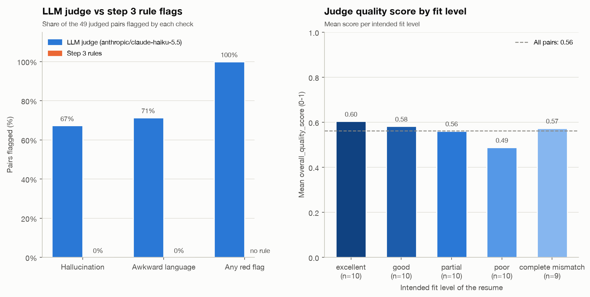

# Resume Coach Synthetic Data Pipeline

Production-grade synthetic-data pipeline that generates resume ↔ job-description pairs at controlled quality levels, validates them with Pydantic, labels each pair with six rule-based failure metrics, self-corrects invalid records via an LLM feedback loop, visualizes the failure patterns, and serves the analysis through a FastAPI REST API.

## Setup

```bash
python3 -m pip install -r requirements.txt
cp .env.example .env         # then set OPENROUTER_API_KEY
python3 -m pytest            # tests make no LLM calls
```

Generation, correction and the judge call OpenRouter and need `OPENROUTER_API_KEY`. Steps 2-4 and the API (without `?judge=1`) run offline. `startup_checks.py` stops with an actionable message when a package or the key is missing. Batch size, models, temperature, retries, industries and templates are set in `config.py`.

## Commands

```bash
python3 pipeline.py          # step 1 -> step 2 -> correction -> step 3 -> step 4
python3 pipeline.py --log    # same, and append the validation result to iteration_log.md
python3 pipeline.py step1    # generate data
python3 pipeline.py step1 --only-jobs
python3 pipeline.py step1 --only-resumes
python3 pipeline.py step1 --only-pairs
python3 pipeline.py step2    # validate the newest complete source run
python3 pipeline.py step2 --only-jobs
python3 pipeline.py step2 --only-resumes
python3 pipeline.py step2 --only-pairs
python3 pipeline.py correct  # LLM correction of the newest step 2 report's invalid records
python3 pipeline.py step3    # failure labels from the newest pairs_enriched file
python3 pipeline.py step4    # charts from the newest failure labels
python3 pipeline.py judge    # LLM judge over the newest pairs_enriched file
python3 pipeline.py judge --limit 10
python3 judge_chart.py       # chart of output/judge_output.json -> docs/judge_summary.png
```

Every step after step 1 reads the newest matching files in `output/`, so steps can be rerun one at a time.

`step1` runs generation in dependency order: jobs, resumes, then pairs. Omit the selector to generate all three. Its selectors are mutually exclusive:

- `--only-jobs` generates job descriptions; it has no data-file dependencies.
- `--only-resumes` generates resumes from the newest existing jobs JSONL file. It exits with an explicit error if no usable jobs file exists.
- `--only-pairs` creates pairs from the newest existing jobs and resumes JSONL files. It validates that both files exist and that each resume references a job in the jobs file before writing pairs.

Jobs-only and resume-only require `OPENROUTER_API_KEY` in the environment or `.env`; pair-only does not call the model. Step2 only needs the installed dependencies and source data; it does not call the model or require an API key.

## Generation

Generation uses the OpenRouter model `openai/gpt-oss-20b` (`MODEL` in `config.py`). Six job-description templates (`prompts/job_description/`) are cycled across ten BLS industries. Each job gets `RESUMES_PER_JOB` resumes at controlled fit levels (`excellent`, `good`, `partial`, `poor`, `complete_mismatch`) and in five writing styles. It writes `jobs_<UTC timestamp>.jsonl`, `resumes_<UTC timestamp>.jsonl`, and `pairs_<UTC timestamp>.jsonl` under `output/`. Pair rows reference job and resume trace IDs. Step1 decodes model replies as JSON objects but does not perform Pydantic schema validation.

## Validation

Step2 validates job descriptions, resumes, and pair records using Pydantic, including cross-record references and resume fit levels. Without a selector, it validates the newest jobs, resumes, and pairs JSONL file independently. Its mutually exclusive selectors are:

- `--only-jobs` validates the newest jobs JSONL file only.
- `--only-resumes` validates the newest jobs and resumes files; job records are checked as dependencies, but only resume results are included in the report.
- `--only-pairs` validates the newest jobs, resumes, and pairs files; jobs and resumes are checked as dependencies, but only pair results are included in the report.

Selected modes choose the newest file for each required type independently, so separately generated stages can be checked together. Step2 reports a clear missing-file error when a required source is unavailable. Running `python3 pipeline.py` with no arguments generates all three artifact types and validates the exact run it just generated. Use `step1` or `step2` to run a single step.

Each validation invocation writes three artifacts under `output/`, named with its UTC timestamp:

- `validated_data_<timestamp>.json` contains validated records with their record type and source location.
- `invalid_<timestamp>.jsonl` contains failed source records, locations, and categorized errors.
- `schema_failure_modes_<timestamp>.json` summarizes category counts, failure percentages, common fields, and the observed validation success rate. The 90% success rate is a target, not a guarantee.
- `pairs_enriched_<timestamp>.jsonl` holds one row per valid pair, with the job and resume joined. Step 3 and the judge read it.

Schema failures reject a record. Hallucination and awkward-language checks only add warnings to valid resumes.

## Correction

`python3 pipeline.py correct` (also part of the default run) sends each invalid job or resume back to the model with its validation errors, for up to `MAX_ATTEMPTS` turns. Pipeline-assigned IDs are restored after each reply, then the corrected files are validated again. Pair errors are not correctable. It writes `corrected_jobs_*`, `corrected_resumes_*`, a per-turn `correction_log_*.jsonl` and a `correction_report_*.json` with success rates by category and attempt.

## Failure labels (step 3)

Step 3 labels every pair in the newest `pairs_enriched_*.jsonl` with six rule-based flags:

| Flag | Fires when |
|---|---|
| `skills_gap_flag` | Jaccard overlap of required and resume skills is below 0.4 |
| `experience_mismatch_flag` | resume years are under 50% of the required years |
| `seniority_mismatch_flag` | inferred seniority is more than one level from the job's |
| `missing_core_skills_flag` | one of the job's first `CORE_SKILL_COUNT` (3) required skills is missing |
| `hallucination_flag` | e.g. 20+ expert skills, an entry-level overclaim, or an impossible timeline |
| `awkward_language_flag` | buzzword density or repetition passes the limits in `resume_metrics.py` |

It writes `failure_labels_<timestamp>.jsonl` (flags plus the numbers behind them) and `failure_stats_<timestamp>.json` (overall rates, rates by fit level, template and writing style, flag correlation, distributions and a spot-check sample). Thresholds live in `resume_metrics.py` and `config.py`, and steps 2, 3 and the API share them.

## Charts (step 4)

Step 4 writes 10 PNGs and `failure_rates_table.csv` to `visualizations/<timestamp>/`. The charts cover flag correlation, failure rates by fit level, job template, writing style and niche vs standard roles, the schema-error heatmap, hallucinations by seniority, skills overlap by fit level, and correction success and attempts. Target lines come from `FAILURE_TARGETS` in `config.py`. A chart with no data is written as a placeholder PNG that says why.

## LLM judge

`python3 pipeline.py judge` sends every valid pair in the newest `pairs_enriched_*.jsonl` to a second model (`JUDGE_MODEL` in `config.py`, `anthropic/claude-haiku-5.5`, a different family from the generator) with the prompt in `prompts/llm_judge.txt`. The judge looks for what the step 3 rules miss: hallucinations, awkward language, a narrative fit assessment, and red flags such as gaps or inconsistent progression. Resume and job metadata are not sent, so the intended fit level cannot bias it. It is optional, is not part of the default run, and needs `OPENROUTER_API_KEY`; `--limit N` judges only the first N pairs.

It writes `output/judge_output.json`, overwritten on each run, with:

- `results`: one verdict per pair in the judge schema (`trace_id` is the resume's), plus `pair_id`, `fit_level` and the step 3 rule flags for the same resume.
- `summary`: hallucination, awkward-language and red-flag rates, the mean quality score overall and per fit level, and how often the judge agrees with the rule flags.
- `failures`: pairs with no valid verdict after `JUDGE_MAX_ATTEMPTS` turns.

### Latest judge run



The judge ran on all 49 valid pairs from run `20261014T132013219616Z` with `anthropic/claude-haiku-5.5` (`docs/judge_summary.png`, regenerate with `python3 judge_chart.py`):

- **The judge finds what the rules miss.** It flagged hallucinations in 67% of pairs and awkward language in 71%. The step 3 rules flagged 0% of either, so agreement is 33% and 29%. The rules only catch blatant patterns, such as 20+ expert skills or a high buzzword density, while the judge catches implausible claims. One example is a "good"-fit RN resume claiming medication administration "for 40+ patients daily". Another is a non-licensed Patient Care Associate "leading interdisciplinary meetings".
- **Every pair has at least one red flag.** 30 of 49 pairs have an unexplained employment gap, most often between graduation and the first role. Other recurring flags are responsibilities that exceed the job title and skill years longer than the roles that used them.
- **Quality score barely tracks fit.** The mean is 0.56. By fit level it runs from 0.60 for "excellent" to 0.49 for "poor", and "complete mismatch" scores 0.57. The score rates the resume itself, while fit is covered by `fit_assessment` and the step 3 flags.

These numbers are a snapshot of one 49-pair run, and `output/` is not committed.

## Review API

```bash
uvicorn api:app --reload    # http://localhost:8000, interactive docs at /docs
```

The API scores resumes with the same functions as step 3, so its flags match `failure_labels_*.jsonl` for the same pair. It needs no API key unless `?judge=1` is used.

- `GET /health` returns the status, the API version, and the timestamp of the newest `failure_stats_*.json` (or `null`).
- `POST /review-resume` takes `{"resume": {...}, "job": {...}}`, and `job` is optional. Resumes and jobs use the pipeline's field shapes, but `metadata` is optional and lists may be empty. The response contains:
  - `resume_checks`: seniority, years of experience, and hallucination and buzzword details.
  - `job_fit`: skill overlap, missing core skills, and the experience and seniority gaps. It is `null` without a job.
  - `integrity`: whether the resume reached its intended fit. The intended fit comes from `resume.metadata.fit_level`; without one, `integrity` is `null`.
  - `flags`, `triggered_flags` and `failure_count`: the two resume-side flags without a job, or all six with one.
  - `schema_warnings`: what the strict pipeline schemas would reject. These are informational only.
  - `detail`: plain-language reasons for each flag.
  - `judge`: the LLM judge verdict with `?judge=1`, otherwise `null`. It makes one model call with reasoning off and needs `OPENROUTER_API_KEY`.
- `GET /analysis/failure-rates` returns the overall and per-group failure rates from the newest step 3 run. Add `?include=correlation,distributions,spot_check` for the larger sections. It returns 404 if step 3 has not run yet.

Every error is JSON: 422 `validation_error` for missing fields, wrong types or malformed JSON, 404 `no_failure_stats`, and 500 `internal_error`. With `?judge=1`: 503 `judge_unavailable` without an API key, 502 `judge_failed` for an invalid model reply, and 504 `judge_timeout` after `JUDGE_API_TIMEOUT_SECONDS` (9 s).

```bash
curl -s localhost:8000/review-resume -H 'content-type: application/json' -d '{
  "resume": {
    "contact_info": {"name": "Ana Diaz", "email": "ana@example.com", "phone": "+1-202-555-0100", "location": "Austin, TX"},
    "education": [{"degree": "BS Computer Science", "institution": "UT Austin", "graduation_date": "2019-05-15"}],
    "experience": [{"company": "Acme", "title": "Data Engineer", "start_date": "2019-07-01",
                    "responsibilities": ["Built ETL pipelines"], "achievements": ["Cut load time 40%"]}],
    "skills": [{"name": "Python", "proficiency_level": "Advanced", "years": 5}, {"name": "SQL", "proficiency_level": "Advanced"}]
  },
  "job": {"title": "Senior Data Engineer",
          "requirements": {"required_skills": ["Python", "SQL", "Airflow"], "experience_years": 5, "experience_level": "senior"}}
}'
```
